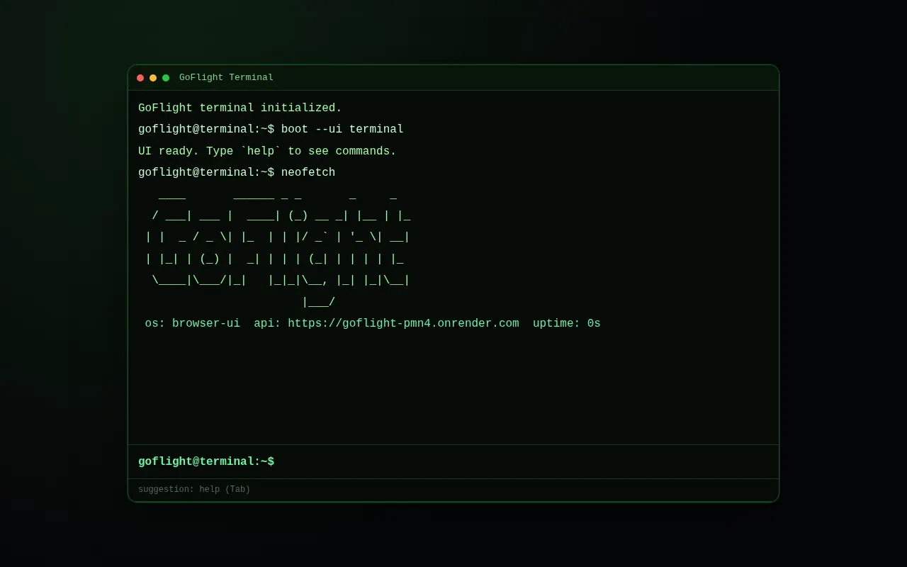

# GoFlight

A flight lookup dashboard: a Go API that combines flight status with current weather, behind a terminal-style Vue front end.

**Status:** a side project built for fun; it runs locally (steps below) and is not hosted.



## Features

- `GET /api/v1/dashboard/:flight` returns flight status (AviationStack) and current weather (Open-Meteo) in one response
- Both upstream calls run concurrently, each behind a circuit breaker (`sony/gobreaker`) with timeouts
- Responses are cached in Redis; if Redis is not set or unreachable, an in-memory cache is used, and a stale entry is served when an upstream fails
- JSON logs (`slog`) with request IDs, Prometheus metrics at `/metrics`, and `/healthz` and `/readyz` probes
- Terminal UI with command history, aliases, tab completion and `&&` chaining. Commands: `help`, `flight <code>`, `about`, `status`, `uptime`, `neofetch`, `demo`, `boot`, `height <px>`, `clear`

## Stack

- [Go](https://go.dev) 1.25 with [Gin](https://gin-gonic.com), Redis (`go-redis`), Prometheus client
- [Vue 3](https://vuejs.org) with [Vite 5](https://vite.dev)
- Docker and Docker Compose, plus Kubernetes manifests in `k8s/`

## Project structure

```
GoFlight/
├── cmd/api/              # server entry point, middleware, graceful shutdown
├── internal/
│   ├── services/         # aggregator: fan-out, circuit breakers, cache
│   ├── external/         # AviationStack, Open-Meteo, Redis and memory cache clients
│   ├── handlers/         # HTTP handlers (with tests)
│   └── middleware/       # logging and metrics
├── mock/                 # fake fetchers for tests
├── frontend/             # terminal-style Vue app
├── k8s/                  # namespace, configmap, secret, deployment, service, ingress, HPA
└── scripts/              # dev-local.sh / stop-local.sh
```

## Run locally

Requires Go 1.25+ and Node.js. Redis is optional.

```sh
cp .env.example .env      # then fill in the values
bash scripts/dev-local.sh # API on :8080 (hot reload with Air), front end on :5173
bash scripts/stop-local.sh
```

Environment variables (see `.env.example`):

| Name | Purpose |
|------|---------|
| `AVIATIONSTACK_API_KEY` | Required for flight lookups. Get a key at [aviationstack.com](https://aviationstack.com) |
| `AVIATIONSTACK_BASE_URL` | Defaults to `http://api.aviationstack.com/v1` |
| `OPENWEATHER_BASE_URL` | Weather API base, defaults to Open-Meteo (`https://api.open-meteo.com/v1`, no key needed) |
| `OPENWEATHER_LAT`, `OPENWEATHER_LON`, `DEFAULT_WEATHER_CITY` | Location used for the weather panel (defaults to Frankfurt) |
| `REDIS_URL` | Optional; falls back to an in-memory cache |
| `CACHE_TTL` | Cache lifetime in seconds |
| `PORT` | API port, default `8080` |
| `FRONTEND_ORIGINS` | Comma-separated CORS origins |
| `VITE_API_BASE` | API URL used by the front end, default `http://localhost:8080` |

`OPENWEATHER_API_KEY` is listed in `.env.example` but is not read by the current code.

Tests and build:

```sh
go test ./...
npm --prefix frontend run build
```

Or run the API with Redis in Docker: `docker compose up --build`.

## Deploy

- **API:** the `Dockerfile` builds a static Go binary on Alpine. Deploy it to any container host and set the variables above. Kubernetes manifests are in `k8s/`; `k8s/secret.yaml` holds placeholders only.
- **Front end:** build `frontend/` with `VITE_API_BASE` set to the API URL and serve `frontend/dist` from any static host; add that host to the API's `FRONTEND_ORIGINS`.

## License

[MIT](LICENSE)
